# Solution Atlas — Complete Feature Screenshots

A comprehensive visual walkthrough of every page, section, and feature in the Solution Atlas (DXP Solution Intelligence) application.

---

## 1. Incident Workspace (Main Page)

The primary landing page and investigation hub. This is where support consultants spend most of their time.

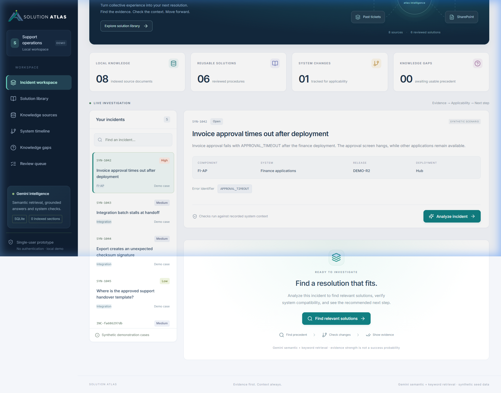

**Key sections visible:**
- **Sidebar navigation** — Dark-themed left panel with brand logo ("Solution Atlas"), workspace selector ("Support operations · DEMO"), and 6 navigation items with badge counts
- **Intelligence Hero banner** — "The right fix. The full picture." hero section with animated knowledge map showing connected sources (Internal KB, Past tickets, SAP references, SharePoint) flowing into Atlas Intelligence
- **Stats row** — Four metric cards: Local Knowledge (08), Reusable Solutions (06), System Changes (01), Knowledge Gaps (00)
- **Incident list panel** — Searchable list of incidents with ID, priority badge (High/Medium/Low), title, component, and case type
- **Incident context card** — Selected incident details: ID, state pill, title, description, component/system/release/deployment fields, error identifier code, and "Analyze incident" CTA button
- **Ready to Investigate prompt** — "Find a resolution that fits." with three-step flow: Find precedent → Check changes → Show evidence
- **Sidebar status panel** — Gemini intelligence status, database backend, indexed sections count, and single-user prototype notice

---

## 2. AI-Powered Incident Analysis (Feature)

The core intelligence feature — analyzes an incident against the knowledge base, checks system compatibility, and produces resolution guidance.

### Analysis Results

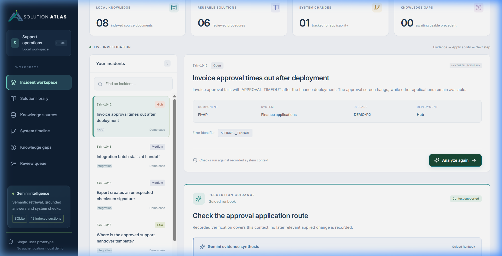

**Key sections visible:**
- **Resolution Guidance card** — Answer type "Guided runbook", status "Context supported" (green), procedure title, and explanation
- **Gemini evidence synthesis** — AI-generated claims with intent classification

### Analysis Results — Runbook Steps & Evidence (Scrolled)

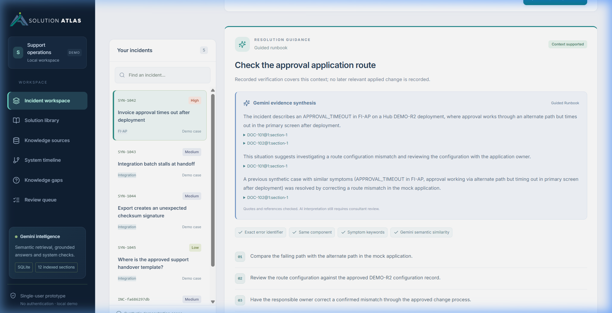

**Key sections visible:**
- **Gemini evidence synthesis** — Claims with inline citations, expandable source quotes, and "Clarify with the consultant" follow-up questions
- **Guided runbook steps** — Numbered procedure steps (01, 02, 03…)
- **Verification section** — "Verify the outcome" with validation criteria
- **Supporting Evidence strip** — Source documents with type-coded icons (Ticket, Internal KB, Vendor reference), IDs, and version numbers
- **Alternative solutions panel** — Expandable accordion with context-compatibility status pills

---

## 3. Solution Library

A catalog of all reviewed, published resolution procedures organized as cards.

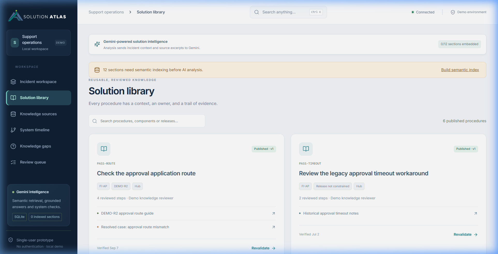

**Key sections visible:**
- **Page heading** — "REUSABLE, REVIEWED KNOWLEDGE" / "Solution library"
- **Search toolbar** — Filter bar + published procedure count
- **Procedure cards** — Each with: Book icon, Published status, procedure ID, title, component/release/deployment tags, step count, owner, linked source documents, verification date, and "Revalidate →" action

---

## 4. Knowledge Sources

Upload and manage the evidence base that powers all analysis.

### Source Connections & Upload Zone

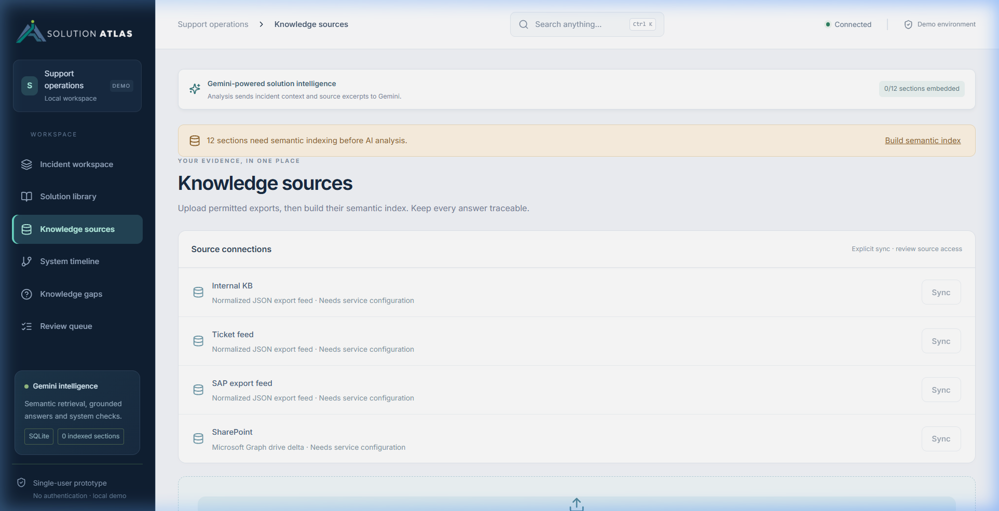

**Key sections visible:**
- **Source connections panel** — Configured connectors (Internal KB, SAP export feed, Ticket feed, SharePoint) with sync status and "Sync" buttons
- **Upload zone** — "Add to your knowledge base" with format support (PDF, DOCX, MD, TXT, CSV, JSON), source type selector, and "Choose a file" button

### Source Inventory Table & Ingestion Activity

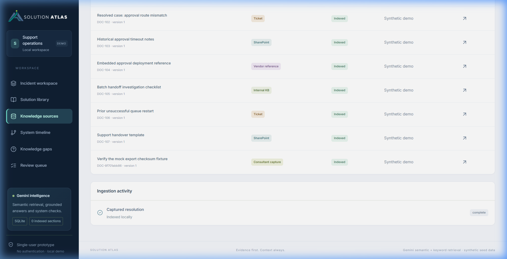

**Key sections visible:**
- **Source inventory table** — Columns: Document (title/ID/version), Source (color-coded type), State (Indexed/Processing/Draft), Provenance, and inspect button
- **Ingestion activity** — Recent upload/extraction jobs with status icons and processing stage

---

## 5. System Timeline

Track system changes that affect procedure applicability.

### System Cards & Change History

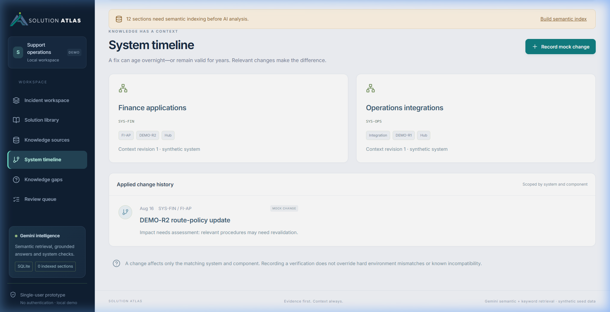

**Key sections visible:**
- **Page heading** — "KNOWLEDGE HAS A CONTEXT" / "System timeline" with "Record mock change" button
- **System cards** — System name, ID, component/release/deployment tags, context revision

### Change Timeline (Scrolled)

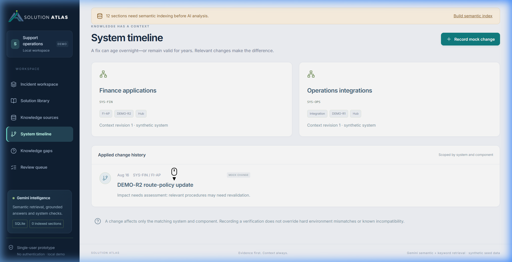

**Key sections visible:**
- **Applied change history** — Vertical timeline with date, scope, "MOCK CHANGE" tags, descriptions, and impact assessments
- **Explanation note** — Info card about change scope and revalidation rules

---

## 6. Knowledge Gaps

Track incidents where no usable precedent exists and manage the capture-to-publish workflow.

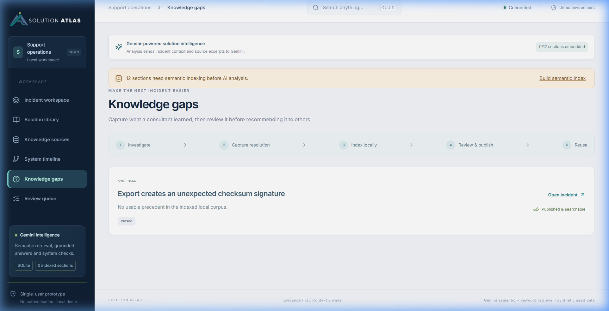

**Key sections visible:**
- **Workflow strip** — 5-step flow: Investigate → Capture resolution → Index locally → Review & publish → Reuse
- **Gap cards / empty state** — Guidance to explore a gap scenario, with actions to open incident, capture resolution, review draft, or see published confirmation

---

## 7. Review Queue

Review captured resolutions before publishing them to the searchable knowledge base.

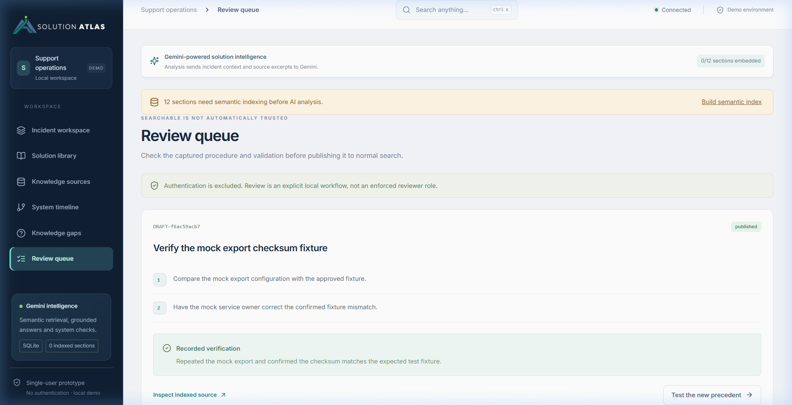

**Key sections visible:**
- **Authentication notice** — "Authentication is excluded. Review is an explicit local workflow."
- **Empty/draft state** — Draft procedure cards with numbered runbook steps, verification section, "Inspect indexed source" link, and "Approve & publish" button

---

## 8. Command Search Palette (Feature)

Global search accessible via `Ctrl+K` or the search bar.

### Open

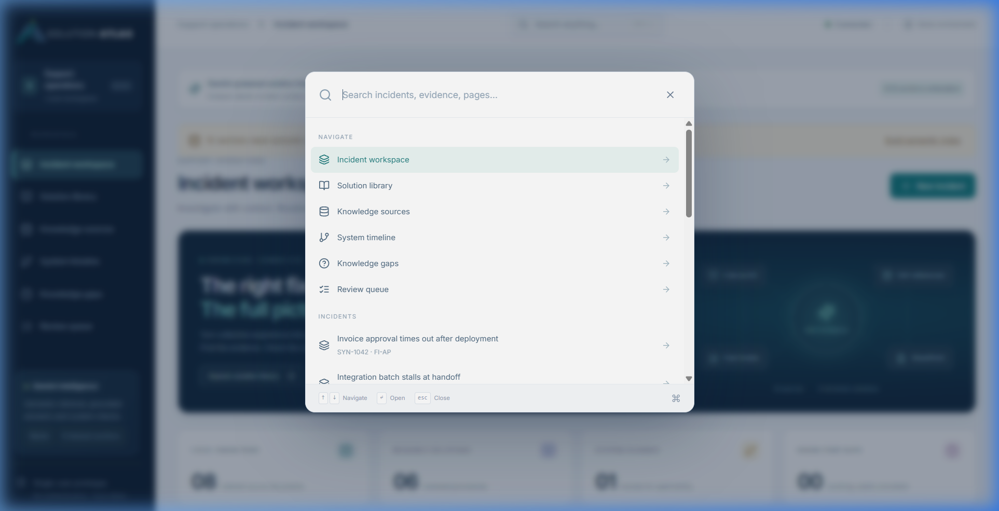

### Filtered

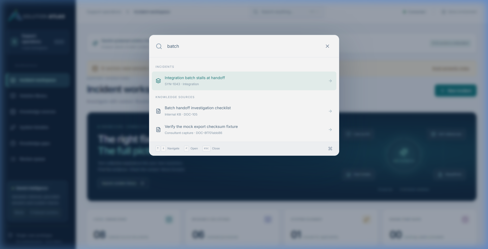

**Key sections visible:**
- **Blurred backdrop overlay** dimming background content
- **Navigate section** — Quick links to all 6 pages
- **Incidents section** — All incidents searchable by title/ID/component
- **Knowledge sources section** — All documents searchable
- **Keyboard shortcuts** — ↑↓ Navigate · ↵ Open · esc Close

---

## 9. Create Incident Modal (Feature)

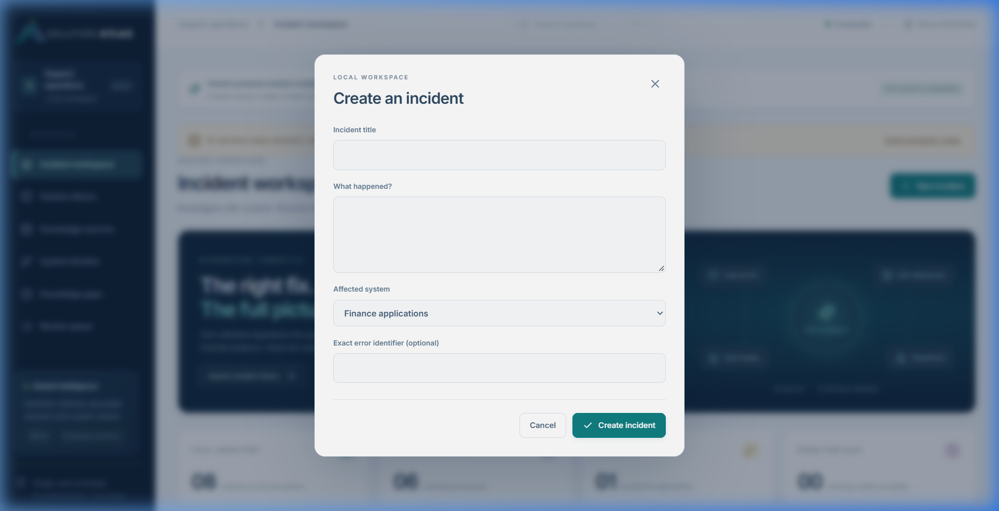

**Key sections visible:**
- **Form fields** — Incident title, "What happened?" textarea, affected system dropdown, optional error identifier
- **Footer** — Cancel + "Create incident" buttons

---

## 10. Record Mock Change Modal (Feature)

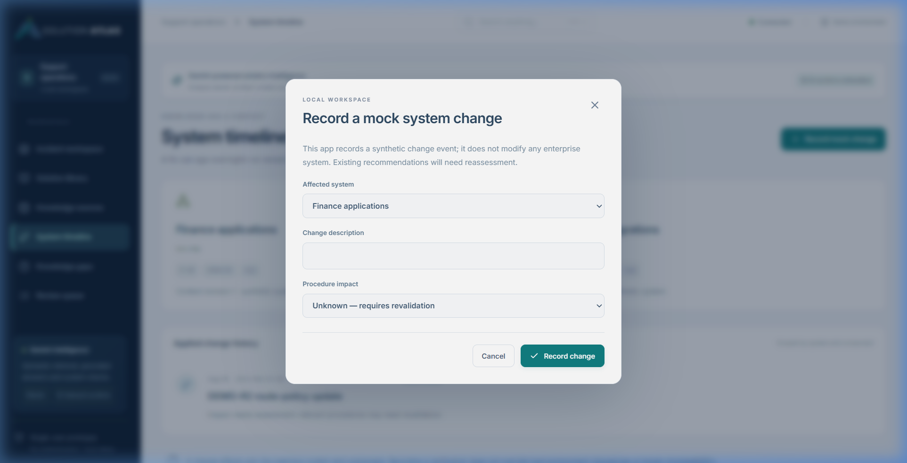

**Key sections visible:**
- **Description** — "This app records a synthetic change event; it does not modify any enterprise system."
- **Form fields** — Affected system dropdown, change description, procedure impact selector (Unknown / Known incompatible)

---

## 11. Evidence Drawer (Feature)

Slide-in panel for inspecting the full source text of any knowledge document.

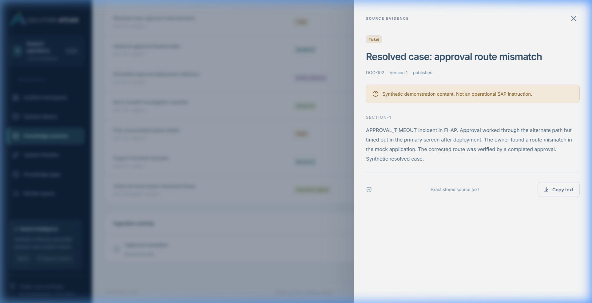

**Key sections visible:**
- **Source type badge** (color-coded), document title, ID/version/status metadata
- **Synthetic content notice** for demo data
- **Source sections** — Full extracted text by section
- **Footer** — "Exact stored source text" label + "Copy text" button

---

## Summary

| # | Page / Feature | Screenshot |
|---|---|---|
| 1 | Incident Workspace | `01_incident_workspace.png` |
| 2 | AI Analysis Results | `02_analysis_result.png` |
| 3 | AI Analysis (scrolled) | `03_analysis_scroll.png` |
| 4 | Solution Library | `04_solution_library.png` |
| 5 | Knowledge Sources | `05_knowledge_sources.png` |
| 6 | Knowledge Sources (table) | `06_knowledge_sources_table.png` |
| 7 | System Timeline | `07_system_timeline.png` |
| 8 | System Timeline (scrolled) | `08_system_timeline_scroll.png` |
| 9 | Knowledge Gaps | `09_knowledge_gaps.png` |
| 10 | Review Queue | `10_review_queue.png` |
| 11 | Command Search (open) | `11_command_search_open.png` |
| 12 | Command Search (filtered) | `12_command_search_filter.png` |
| 13 | Create Incident Modal | `13_create_incident_modal.png` |
| 14 | Record Change Modal | `14_record_change_modal.png` |
| 15 | Evidence Drawer | `15_evidence_drawer.png` |
